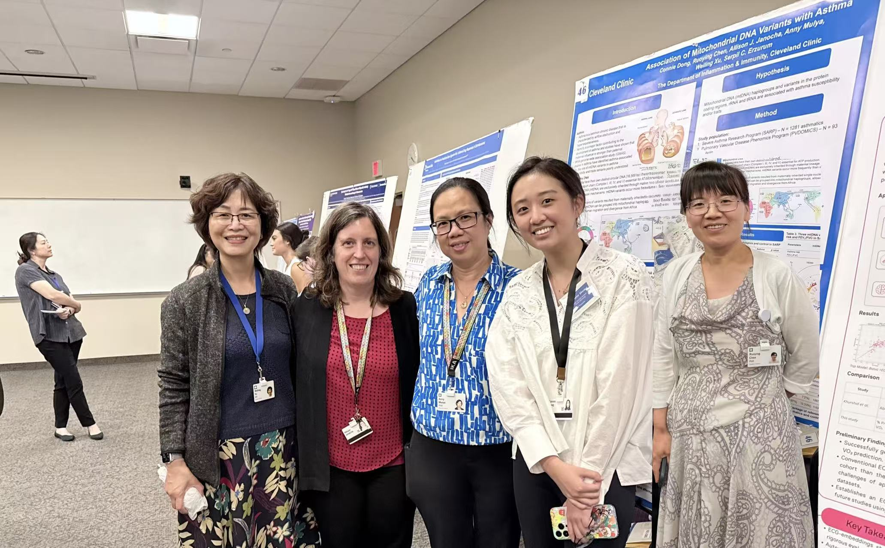

### Mitochondrial DNA and Asthma Risk

Erzurum Lab | Cleveland Clinic | 2026 – Present

As an undergraduate research student, I participated the ongoing research investigating the association between mitochondrial DNA (mtDNA) and asthma risk. I contributed to the research through laboratory procedures, data analysis, and preparation of scientific figures. I presented this research at Cleveland Clinic's Annual Summer Student Poster Showcase, gaining experience in communicating scientific findings to a broader research audience.

----

